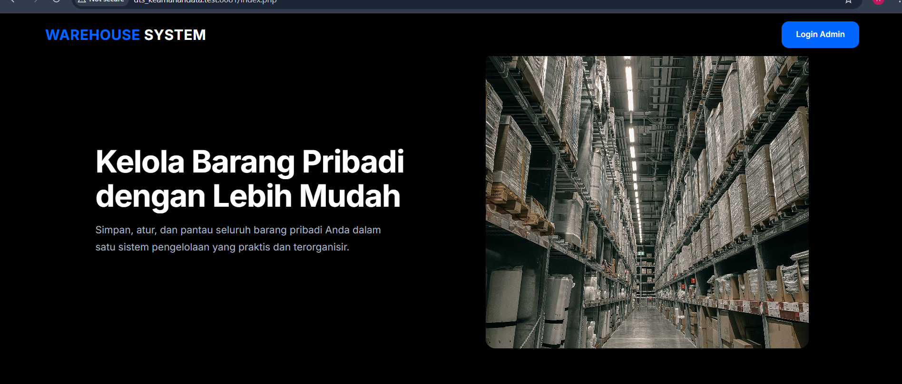
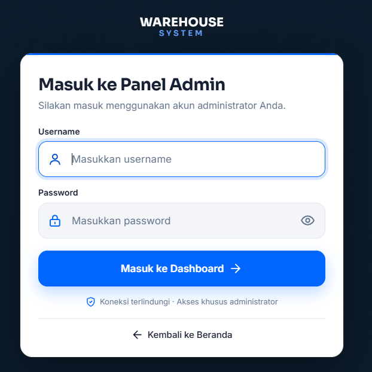
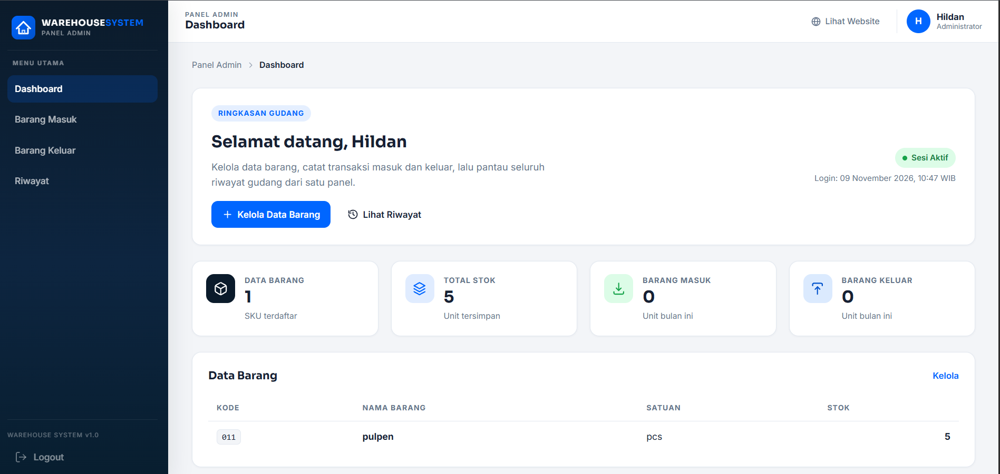
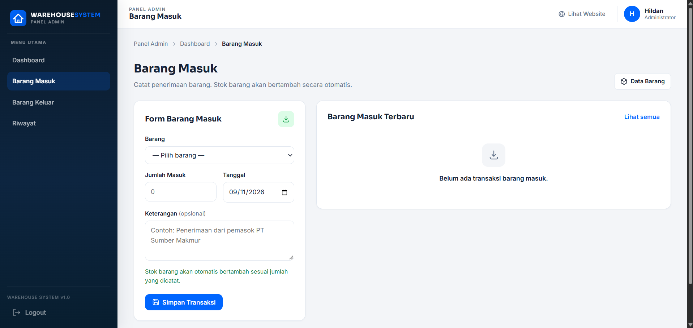
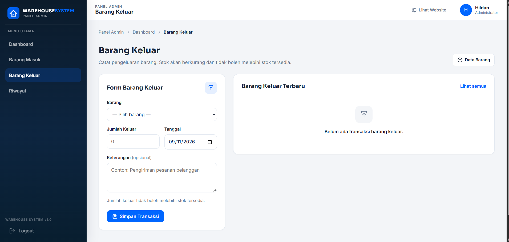
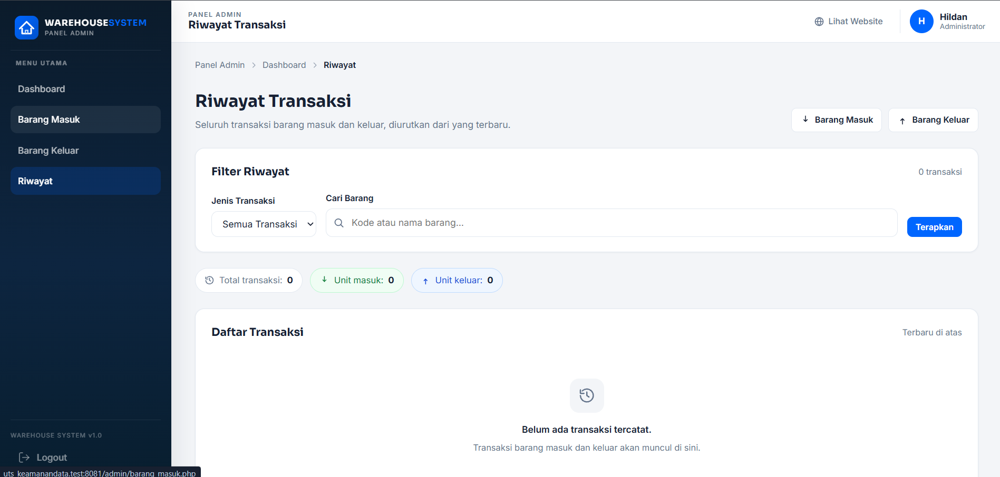
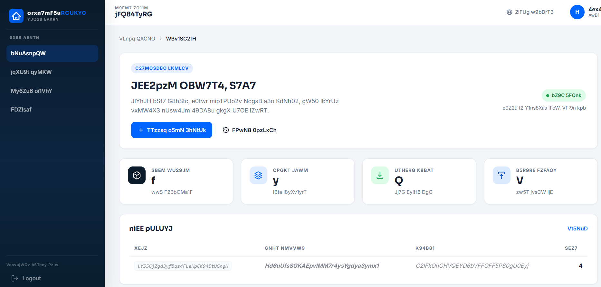

# WAREHOUSE SYSTEM — Sistem Informasi Manajemen Gudang Pribadi

Sistem informasi manajemen gudang pribadi berbasis web dengan **landing page publik** dan **halaman admin** yang dilindungi password + dekripsi data terenkripsi pada saat menampilkan konten admin.

Teknologi: **PHP Native + HTML5 + CSS3 + JavaScript**, database **MySQL/MariaDB** (PDO), aplikasi di Laragon (`C:\laragon\www\UTS_KeamananData`).

## Fitur

### Landing Page (`index.php`)

- Header hitam: logo `WAREHOUSE SYSTEM` di kiri, tombol `Login Admin` di kanan
- Hero dua kolom: teks di kiri, foto gudang di kanan (full cover)
- Section “Organisasi yang Menyenangkan” + footer
- Navigasi ke `admin/login.php` untuk masuk panel admin

### Halaman Admin (`admin/`)

- **Login** (`admin/login.php`): username + password. Password diverifikasi pakai `password_verify()` terhadap hash `password_hash()` (bcrypt). Status benar/salah menentukan apakah data ditampilkan asli atau acak.
- **Dashboard** (`admin/dashboard.php`): statistik Data Barang, Total Stok, Barang Masuk, Barang Keluar, tabel Data Barang, akses cepat, Transaksi Terbaru, Informasi Sesi, Catatan.
- **Data Barang** (`admin/barang.php`): tambah/edit/hapus master barang + cari.
- **Barang Masuk** (`admin/barang_masuk.php`): catat penerimaan, stok bertambah otomatis.
- **Barang Keluar** (`admin/barang_keluar.php`): catat pengeluaran, stok berkurang otomatis (tidak boleh melebihi stok).
- **Riwayat** (`admin/riwayat.php`): daftar seluruh transaksi + filter jenis & cari barang.

## Screenshot Aplikasi

Screenshot diambil langsung dari aplikasi (`Win+Shift+S`), disimpan di folder `screenshots/`. File `04-data-barang.png` sengaja tidak dimasukkan.

### Landing Page



### Login Admin



### Dashboard Admin



### Barang Masuk



### Barang Keluar



### Riwayat Transaksi



### Bukti Enkripsi di Database (phpMyAdmin)



## Keamanan & Enkripsi (materi inti)

**Login password (hashing, bukan enkripsi)**

Password admin di-hash bcrypt via `password_hash()`, tidak pernah disimpan plaintext (`database/create_admin.php`, `admin/login.php`). Verifikasi pakai `password_verify()`. Hashing satu arah — tidak bisa di-decrypt.

**Data admin dienkripsi simetris AES-256-CTR**

Field teks sensitif **di-enkripsi sebelum disimpan** ke database, format `enc:v1:<base64(iv + ciphertext)>`, kunci 32 byte dari `config/app.key`, memakai `openssl_encrypt()` mode `aes-256-ctr` (`config/encryption.php`). Yang dienkripsi: `barang.kode_barang`, `barang.nama_barang`, `barang.satuan`, `transaksi.keterangan`. Field numerik/relasional (`stok`, `jumlah`, `tanggal`, `jenis`) tetap plaintext agar query hitung stok & urut tanggal tetap berfungsi.

**Dekripsi saat tampil di admin**

Setelah login, setiap konten admin dilewat `decrypt_sensitive()` untuk ditampilkan asli. Jika password salah, tetap bisa membuka halaman tapi isinya tampil acak (`scramble_page_output`) dan aksi simpan ditolak (`decryption_unlocked()`). Ini model demonstrasi UTS — pembatasan tampilan tidak menggantikan kontrol akses.

Jalur enkripsi/dekripsi:

- Simpan barang: `admin/barang.php` → `encrypt_sensitive()`
- Simpan transaksi: `config/transaksi.php` (`simpan_transaksi()`) → `encrypt_sensitive()` untuk `keterangan`
- Tampil: semua halaman admin → `decrypt_sensitive()`

Alat bantu lain: PDO prepared statement (anti SQL Injection), token CSRF, session `HttpOnly + SameSite=Lax` + strict mode + idle timeout 30 menit, `session_regenerate_id()` setelah login, baris SQL injection & XSS diantisipasi via output escaping `e()`.

> Catatan jujur buat dosen: kunci AES bukan diketik user di form login — kunci diambil server dari `config/app.key`. Password login berfungsi sebagai gate dekripsi. Ini simetris (satu kunci untuk enkripsi + dekripsi), bukan asimetris (tidak ada RSA/public-private key).

## Struktur Proyek

```
UTS_KeamananData/
├── index.php                  # Landing page
├── admin/
│   ├── dashboard.php          # Dashboard admin
│   ├── barang.php             # CRUD data barang
│   ├── barang_masuk.php       # Transaksi masuk
│   ├── barang_keluar.php      # Transaksi keluar
│   ├── riwayat.php            # Riwayat semua transaksi
│   ├── login.php              # Form login admin
│   ├── logout.php             # Keluar
│   └── includes/              # header.php + footer.php admin
├── assets/
│   ├── css/                   # style.css (landing), login.css, admin.css
│   ├── js/                    # script.js (landing), login.js, admin.js
│   └── img/                   # hero-warehouse.jpg, about-workers.jpg
├── config/
│   ├── database.php           # Koneksi PDO (DB_HOST/PORT/NAME/USER/PASS)
│   ├── auth.php               # Session, CSRF, flash, format tanggal
│   ├── encryption.php         # AES-256-CTR + gate dekripsi
│   ├── transaksi.php          # simpan_transaksi() + update stok atomik
│   └── app.key                # Kunci AES 32 byte (rahasia, jangan commit)
└── database/
    ├── database.sql           # Skema: admin, barang, transaksi, kunci_dekripsi
    ├── create_admin.php       # Buat akun admin pertama (CLI)
    └── setup_encryption.php   # Buat kunci + enkripsi data lama (CLI)
```

## Instalasi

Syarat: PHP + MySQL, aplikasi dijalankan di **Laragon** (`C:\laragon\www\UTS_KeamananData`).

1. Nyalakan Apache + MySQL Laragon.
2. Import database:
   - Buka phpMyAdmin/HeidiSQL, jalankan isi `database/database.sql` (buat database `warehouse_system`).
   - Sesuaikan `config/database.php` bila perlu (default: host `127.0.0.1`, DB `warehouse_system`, user `root` tanpa password).
3. Buat akun admin pertama lewat terminal (CLI):

   ```bash
   php database/create_admin.php
   ```

   Ikuti prompt username + password (password disimpan sebagai hash).
4. Siapkan kunci aplikasi + enkripsi data lama:

   ```bash
   php database/setup_encryption.php
   ```

   Script ini membuat `config/app.key` bila belum ada dan mengenkripsi kolom teks lama tanpa menghapus data.
5. Buka di browser:
   - Landing: `http://localhost/UTS_KeamananData/`
   - Login admin: `http://localhost/UTS_KeamananData/admin/login.php`

## Akun & Kunci

- Akun dibuat lewat `create_admin.php` (tidak ada akun default di SQL — sengaja, password wajib di-hash).
- Kunci AES di `config/app.key` (base64 32 byte) **jangan dibagikan / di-commit**. Hilang = data lama tidak bisa didekripsi lagi.

## Uji Cepat

1. Login admin → dashboard tampil data asli.
2. Tambah barang di `barang.php` → cek di phpMyAdmin kolom `kode_barang`/`nama_barang`/`satuan` berformat `enc:v1:...` (tidak terbaca).
3. Catat Barang Masuk/Keluar → `stok` di `barang` berubah otomatis, `transaksi.keterangan` terenkripsi.
4. Logout → masuk lagi, sidang (session) terputus.

## Lisensi / Akademik

Proyek demo untuk mata kuliah Keamanan Data (UTS). Bukan untuk produksi tanpa audit keamanan (contoh: kunci static di server, CTR tanpa authentication tag, model scramble saat password salah). Periksa & perbaiki sebelum dipakai menyimpan data penting.
